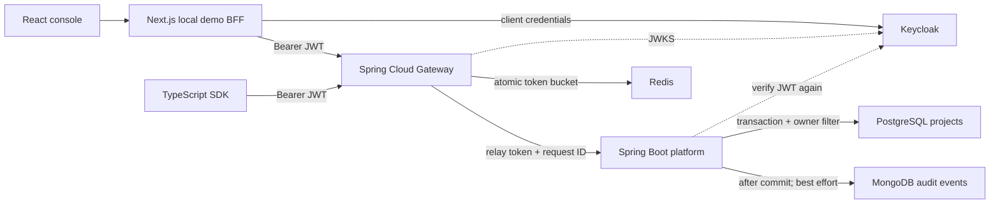

# Identity — an identity-aware API gateway

A runnable portfolio project that makes API security visible: send a request, inspect the selected identity, observe the gateway decision, and trace a successful write into PostgreSQL and MongoDB.

**Stack:** Java / Spring Boot 4, Spring Cloud Gateway, Spring Security, Keycloak (OAuth 2.0 / OIDC), Redis, PostgreSQL, MongoDB, Next.js / React / TypeScript, and a typed developer SDK. Tests use JUnit 6 (Jupiter), Mockito, and Testcontainers 2.

Two presentation modes:

- **Live stack:** real signed JWTs, real Redis token buckets, real databases, and a dashboard connected to Spring.
- **Simulation:** the same console with an explicitly labeled, in-memory policy simulator. No Docker or Java required. It does **not** demonstrate cryptographic JWT validation or database persistence.

No generated traffic is labeled production traffic. The dashboard starts from observed requests. The repository includes measurement tools rather than assuming the résumé’s uptime, volume, or coverage claims.

See [recorded verification results](docs/verified-results.md): 97.78% Java line coverage, passing live/browser tests, and the scope of the measured load and security checks.

## Run the complete demo

Install Docker Desktop with the Linux engine. Allow approximately 6 GB of memory and several minutes for the first image build.

```sh
docker compose --profile console up -d --build
```

Open **http://localhost:3000**. Wait until the console says **Live stack**. Keycloak can take another minute on its first start.

| Local endpoint | Purpose |
|---|---|
| `http://localhost:3000` | Presentation console |
| `http://localhost:8088` | Spring Cloud Gateway |
| `http://localhost:8088/actuator/health` | Public readiness check |
| `http://localhost:8180` | Keycloak; admin login `admin` / `admin-local-only` |

These services bind to loopback. Databases, Redis, and the platform API have no published ports. Credentials in the realm import and Compose file are **public local demo credentials**. The console intentionally provides a local demo identity switcher; it is not an authenticated production admin console.

With Node.js 22.15+ installed, verify the live behavior:

```sh
npm ci
npm run demo:live
npm run build -w @identity/sdk
node scripts/sdk-demo.mjs
```

The smoke test checks 401, 403, 400, 200, 201, ownership isolation, correlated MongoDB auditing, and Redis 429 responses. Its timestamped results go into `artifacts/live-smoke.json`.

Stop services without deleting data:

```sh
docker compose --profile console down
```

PostgreSQL, MongoDB, Redis, and Keycloak use named volumes. `down -v` additionally deletes this demo’s data; use it only when you want a fresh realm and empty stores.

## Run the lightweight simulation

Requires Node.js 22.15+.

```sh
npm ci
npm run dev
```

Open http://127.0.0.1:3000. The banner will say **Simulation**. In-memory data is shared by the local console process and resets on restart. Stop the Docker console first if it already occupies port 3000.

To develop the UI against the real backend, start `docker compose up -d --build`, copy `apps/console/.env.example` to `apps/console/.env.local`, set `DEMO_MODE=false`, and restart `npm run dev`. The default gateway port is 8088 to avoid common port 8080 conflicts. If you change `GATEWAY_PORT` for Compose, also update `GATEWAY_URL` in your local console environment.

## A five-minute presentation

1. **Overview:** explain the three policies and the difference between observed traffic and a benchmark.
2. **Playground:** send a GET as the developer. Inspect the response headers and JWT claims.
3. Switch to the read-only integration and send a POST. Explain why an authenticated caller receives **403**.
4. Switch to anonymous or malformed-token mode. Explain why these return **401** before routing.
5. Switch back to the developer and create a project. Find `project.created` in **Audit trail → Project mutations**. Match the correlation ID.
6. Click **Generate traffic**. Open **Audit trail → Gateway requests** and filter `429`. Explain the identity-based token bucket.
7. Open **Architecture**, then **Developer SDK**. Explain one design tradeoff and show the runnable SDK example.

See [the interview guide](docs/interview-guide.md) for a detailed script, likely questions, and defensible résumé wording.

## Architecture



Read [architecture decisions and trust boundaries](docs/architecture.md), the [API contract](docs/openapi.yaml), and the [SDK README](packages/sdk/README.md).

## Verification

Docker must be running for Testcontainers. Java sources target 17; runtime images use JDK/JRE 21. Use Maven 3.9+ with JDK 17+ locally.

```sh
mvn -B -ntp clean verify
npm ci
npm run typecheck
npm test
npm run build
npx playwright install chromium
npm run test:e2e
npm audit --audit-level=high
```

- **Gateway:** real RSA-signed tokens and a JWKS server; wrong signature, issuer, audience, expired tokens, scope enforcement, header sanitization, Redis quotas, and protected metrics.
- **Platform:** PostgreSQL and MongoDB Testcontainers; migrations, owner isolation, validation, after-commit auditing, plus Mockito failure-path checks.
- **TypeScript:** SDK errors, token providers, cancellation, simulator policy and ownership.
- **Browser:** request success, forbidden writes, project creation, bursts, audit views, navigation, and mobile width.
- **Coverage:** JaCoCo enforces at least 90% line coverage in each Java service with no production-class exclusions. HTML reports are at `services/{gateway,platform}/target/site/jacoco/index.html`; `npm run coverage:java` writes a weighted summary to `artifacts/coverage.json`.

`Jenkinsfile` defines verification, browser tests, dependency/secret scanning, and container builds. It requires a Linux Jenkins agent with JDK 21, Maven, Node, Docker, and Trivy. A configured pipeline is not evidence of a completed Jenkins run. See [verification and CI](docs/verification.md).

## Repository layout

```text
apps/console/          Next.js console, local BFF, explicit simulator
packages/sdk/          Typed TypeScript HTTP client
services/gateway/     Reactive gateway, security, Redis policies, metrics
services/platform/    Owner-scoped projects and after-commit audit writes
infra/keycloak/       Reproducible realm and service-account scopes
scripts/              Live checks, SDK example, k6 workload, verification
tests/                SDK / simulator tests and Playwright scenarios
docs/                 Architecture, API, presentation, verification
Jenkinsfile           CI pipeline definition
compose.yaml          Local service topology and persistent volumes
```

## Useful troubleshooting

- **Connection unavailable:** inspect `docker compose ps` and `docker compose logs --tail 80 gateway platform keycloak`. The UI never silently falls back from live mode to simulation.
- **Port conflict:** stop only this project’s previous console, or configure a different host port. Do not stop unrelated services.
- **429 after repeated demos:** wait two seconds for the burst bucket to refill.
- **First token request fails:** wait for Keycloak’s realm import. The smoke test waits for readiness.
- **Changed realm JSON has no effect:** imports skip an existing realm. Edit it in Keycloak, or intentionally reset this demo’s volumes.
- **Testcontainers cannot connect:** start Docker Desktop and ensure the selected engine is Linux.
- **Using a different hostname:** the JWT issuer is deliberately pinned to `http://localhost:8180/realms/identity`. Adjust `KC_HOSTNAME` and both services’ `OIDC_ISSUER` together. The internal JWKS URL is independently configurable.
